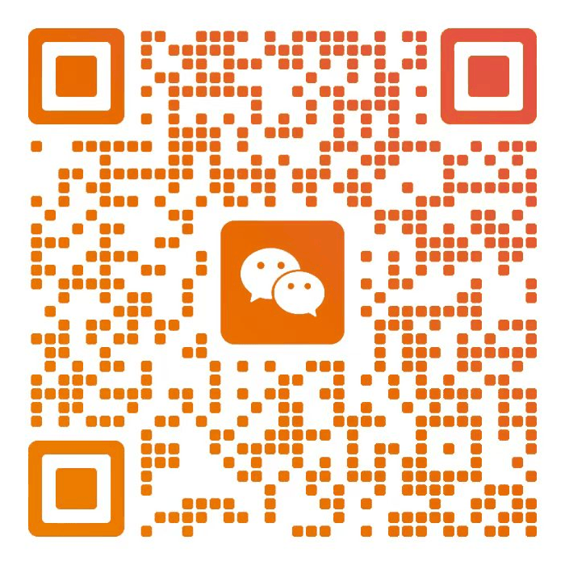

# 联系与勘误

教材、练习与附录都可以自学，遇到卡住的地方不必攒着。这一页只放三件事：联系渠道、能问什么、哪些不在范围内。

## 联系方式

**邮箱**：chirca@163.com

勘误建议走邮箱，便于附上原文、截图和改法。

**微信**：jiayanyide

昵称「嘉言一得·虚竹」，地区广东 揭阳。扫码与搜索微信号是同一个号。

添加时请备注来意，比如「教材勘误」或「第 14 课旺衰」，便于分辨。

## 能问什么

- 教材内容的疑问：某句判断读不通、某处推导接不上、某个例子与正文对不上。
- 错漏与表述问题：引文、年份、表格数值、示例干支。这类修改会记进[版权与版本说明](rights.md)的版本记录。
- 已开设课程与教学服务的咨询，现状见[课程与教学服务](courses.md)。

提勘误时请写明课次、章节标题和具体那一段。十七课的课次与章节号稳定，条目对得上才核得动。能附上截图或原句更好，省一轮来回。

## 不在范围内

本站是个人维护的静态站，不设购买、下单、支付与报名入口，也不设预约占位。

教材与教学只做理论训练与方法讨论，不涉及具体吉凶占卜服务。因此个案批命、排盘与择日请求不在本页受理，发来也不回。与教材无关的商业推广、互推、代运营同样不回。

作者身份与研习年表见[关于嘉言一得](author.md)。

嘉言一得（邝楚嘉）
